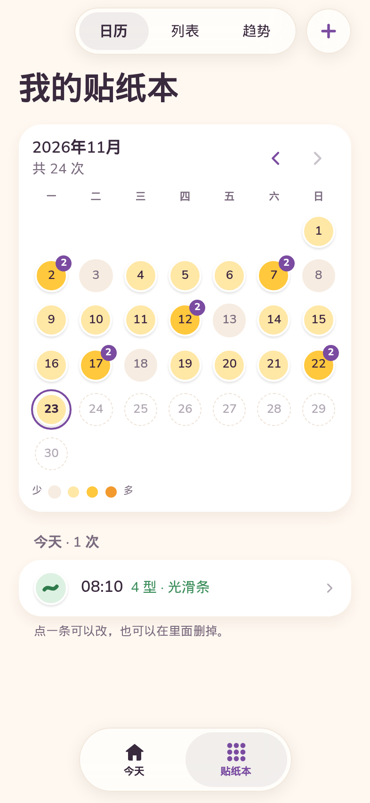
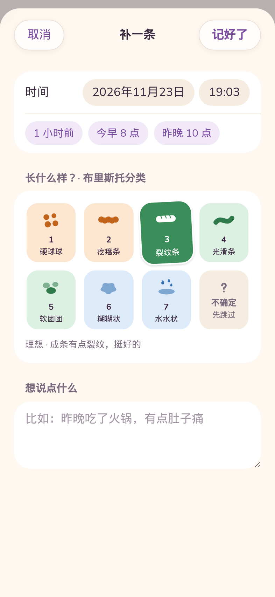
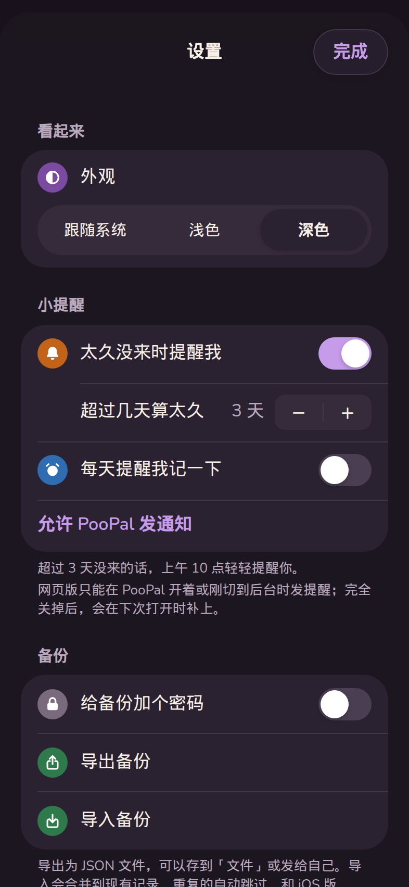

# PooPal

A cute, private poop-frequency and gut-health tracker for everyday personal use, styled as a little sticker journal with a friendly buddy.

**Try it now: [poopal.pages.dev](https://poopal.pages.dev/)**. It is deployed on Cloudflare Pages and works directly in the browser on desktop and mobile. On your phone, use your browser's "Add to Home Screen" (or "Install app") option and it opens full-screen like a native app, even offline.

PooPal is a **frontend-only** project: a Vite + React + TypeScript progressive web app (PWA). There is no backend, no account and no login. Your entries never leave your device; they live in your browser's IndexedDB.

| Light | Dark |
| --- | --- |
|  |  |
|  |  |
|  |  |

## Features

- **One-tap logging.** Press the big sticker to log "now", or backfill an entry you forgot. Undo right from the toast.
- **Bristol stool scale.** Optionally tag each visit with Bristol type 1–7 (or "not sure") and add a short note.
- **Sticker calendar and list.** Every visit is a round sticker on its day, so the week and month read at a glance.
- **Trends.** Weekly and monthly counts over the last 12 periods, Bristol type distribution over 30 days, and the full numbers (average interval, most common type and more).
- **Reminders.** Best-effort "it's been a while" and daily reminders via web notifications (see [Reminder limits](#reminder-limits)).
- **Backup export and import.** Plain JSON or password-encrypted (AES-256-GCM), merged on import without duplicates.
- **Three languages.** 简体中文, English and 日本語, following your system language by default and switchable in Settings.
- **Light and dark appearance.** Follow the system, or pick one.
- **Private by design.** No account, no server, no analytics, no uploads.

## Tech stack

- [Vite](https://vite.dev/) + [React](https://react.dev/) 19 + [TypeScript](https://www.typescriptlang.org/)
- [vite-plugin-pwa](https://vite-pwa-org.netlify.app/) (Workbox service worker, web app manifest, offline support)
- [idb](https://github.com/jakearchibald/idb) for IndexedDB storage
- Web Crypto (PBKDF2-SHA256 + AES-GCM) for encrypted backups
- A small in-house i18n layer (`src/i18n/`)
- [Vitest](https://vitest.dev/) for unit tests and [Playwright](https://playwright.dev/) for end-to-end tests
- ESLint, plus nginx and Docker for self-hosting

## Local development

Requires Node.js 22 or newer.

```bash
npm install
npm run dev          # dev server at http://localhost:5173 (append ?demo for sample data)
npm run lint         # ESLint
npm run typecheck    # TypeScript
npm run build        # production build into dist/ (static files + service worker + manifest)
npm run preview      # serve the production build locally
npm run icons        # regenerate the app icons in public/icons/ from the wordmark
```

`?demo` opens a separate sample database that is regenerated on every reload, so it never touches your real entries.

## Tests

```bash
npm test             # unit tests (stats, reminders, backup format, i18n)
npm run test:e2e     # Playwright end-to-end tests against a production build
```

The first end-to-end run needs a browser: `npx playwright install chromium`, or point `CHROME_PATH` at a local Chrome.

To refresh the README screenshots: `npm run build && npx vite preview --port 4173`, then `node scripts/screenshots.mjs`.

## Deployment

PooPal is a static site with no backend. It **must be served over HTTPS** (localhost excepted): the service worker (offline use and installing), notifications and backup encryption (Web Crypto) are unavailable over plain HTTP.

### Cloudflare Pages

The public instance at [poopal.pages.dev](https://poopal.pages.dev/) runs on Cloudflare Pages. To deploy your own:

- Build command: `npm run build`
- Build output directory: `dist`
- Environment variable: `NODE_VERSION=22` (or newer)

Make sure `index.html`, `sw.js`, `workbox-*.js`, `theme-init.js` and `manifest*.webmanifest` are not cached long-term; otherwise updates won't reach installed apps. Hashed files under `assets/` can be cached forever. `nginx/default.conf` shows the intended caching rules.

### Docker

The image builds the site and serves it with nginx on port 80 inside the container:

```bash
docker build -t poopal .
docker run -d --name poopal --restart unless-stopped -p 8080:80 poopal
```

Put an HTTPS reverse proxy in front of it, for example Caddy:

```
poopal.example.com {
    reverse_proxy 127.0.0.1:8080
}
```

To serve from a sub-path such as `https://example.com/poopal/`, build with `docker build --build-arg BASE_PATH=/poopal/ -t poopal .` and have the reverse proxy strip the `/poopal` prefix.

### Any static host

Run `npm run build` (set `BASE_PATH=/your-path/` for a sub-path) and upload `dist/` to any static file server, following the caching rules above.

## Data and privacy

- Entries are stored in your browser's IndexedDB; settings (appearance, language, reminders) are stored in localStorage. Nothing is sent to any server.
- Data belongs to "this browser on this address": switching phones, browsers or domains, or clearing site data, leaves your entries behind. Export a backup regularly from Settings › Backup.
- Some browsers evict data for sites you haven't opened in a while; apps added to the home screen are usually exempt. PooPal also asks the browser for persistent storage.

## Backup format

Plain backups are JSON:

```json
{ "app": "PooPal", "version": 1, "exportedAt": "2026-11-14T10:00:00.000Z",
  "entries": [{ "timestamp": "2026-11-14T00:30:00.000Z", "bristolType": 4, "note": "hotpot" }] }
```

Encrypted backups encrypt that JSON with AES-256-GCM, using a key derived with PBKDF2-SHA256 (210,000 iterations, 16-byte random salt). `payload` is base64 of "12-byte nonce + ciphertext + 16-byte tag", wrapped as `{ "app", "format": "encrypted", "version", "kdf", "iterations", "salt", "payload" }`.

Imports merge by timestamp (to the second): new entries are added, and existing entries only gain a missing Bristol type or note. Nothing is overwritten.

## Reminder limits

Without a push server, a web page can't schedule local notifications, so reminders are best-effort:

- Reminders fire on time only while PooPal is open or still alive in the background. If it was fully closed, a missed reminder is delivered the next time you open it (daily reminders more than 2 hours late are skipped). Each reminder fires at most once a day.
- Some mobile browsers only allow notifications for apps added to the home screen.
- Truly on-time reminders would need a Web Push server (VAPID keys and a small backend), which PooPal doesn't have.

## Project structure

- `src/logic/`: pure logic (stats, trends, mood, Bristol types, reminder planning, backup encoding and merging, date text, wordmark geometry), all unit-tested
- `src/data/`: IndexedDB entries, settings, notifications, demo data
- `src/i18n/`: translations, one file per language with the same shape as `zh.ts` (missing keys fail the type check)
- `src/components/`: wordmark, the Pal buddy, Bristol stickers and picker, shared controls
- `src/screens/`: Home, Sticker book (calendar / list / trends), entry editor, Settings
- `e2e/`: Playwright tests
- `public/icons/`: PWA icons (generated by `scripts/render-icons.mjs`)
- `nginx/`, `Dockerfile`: self-hosting

See [`DESIGN.md`](DESIGN.md) for the visual system (colors, stickers, the Pal buddy, light and dark) and [`PRODUCT.md`](PRODUCT.md) for the product brief.

## Contributing

Contributions are very welcome! Whether it's a bug fix, a new translation, a design polish or a fresh idea, feel free to open an issue or send a pull request (MR). A few tips:

- Fork the repo and create a branch for your change.
- Run `npm run lint`, `npm run typecheck` and `npm test` before opening the PR (and `npm run test:e2e` for UI changes).
- Keep PooPal private: no accounts, trackers or network uploads of user data.
- For UI changes, follow [`DESIGN.md`](DESIGN.md) and include a screenshot in the PR.
- New UI text needs entries in all three language files under `src/i18n/`.

Thank you for helping PooPal keep your gut company!
