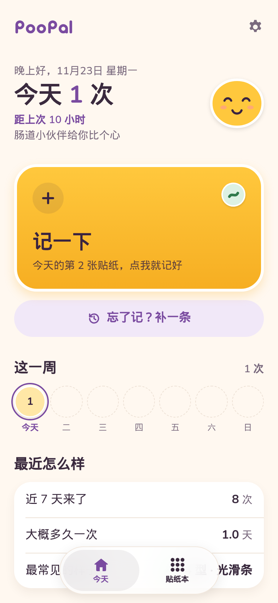
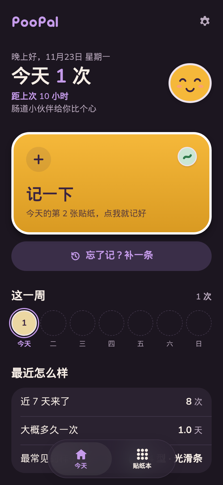
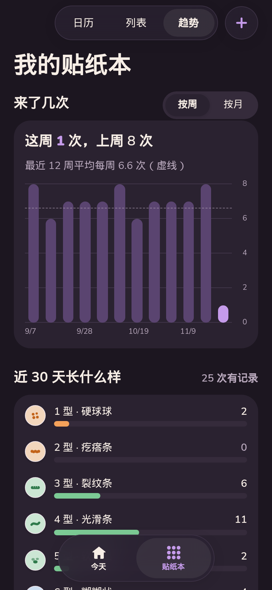

# PooPal

记录便便的小贴纸手帐，网页版（PWA）。一键记录、布里斯托分型和备注、贴纸日历、趋势图、提醒、加密备份。不用登录，数据只存在你自己的浏览器里（IndexedDB）。可以「添加到主屏幕」，用起来像 App，没网也能打开。

> 之前的 iOS（SwiftUI）版本保存在 [`ios-archive`](https://github.com/nickwang94/PooPal/tree/ios-archive) 分支和 `ios-final` 标签里。网页版的备份文件和 iOS 版互通。

| 浅色 | 深色 |
| --- | --- |
|  |  |
|  |  |
|  |  |

## 开发

需要 Node.js 22+。

```bash
npm install
npm run dev          # 本地开发 http://localhost:5173 （加 ?demo 用示例数据）
npm test             # 单元测试（统计、提醒、备份格式，移植自 iOS 的 PoopStatsTests 等）
npm run lint         # ESLint
npm run typecheck    # TypeScript
npm run build        # 生成 dist/（静态文件 + Service Worker + manifest）
npm run icons        # 从字标重新生成 public/icons/ 里的应用图标
```

截图：`npm run build && npx vite preview --port 4173`，然后 `node scripts/screenshots.mjs`（首次需要 `npx playwright install chromium`，或用 `CHROME_PATH` 指向本机 Chrome）。

`?demo` 会打开一个独立的示例数据库（每次刷新重新生成），不会碰到真实记录。

## 部署

PooPal 是纯静态站点，没有后端。**必须用 HTTPS 访问**（localhost 除外）：Service Worker（离线、安装到主屏幕）、通知和备份加密（Web Crypto）在 HTTP 下都不可用。

用 Docker（nginx 提供静态文件，容器内监听 80 端口）：

```bash
docker build -t poopal .
docker run -d --name poopal --restart unless-stopped -p 8080:80 poopal
```

再在前面放一个负责 HTTPS 的反向代理，例如 Caddy：

```
poopal.example.com {
    reverse_proxy 127.0.0.1:8080
}
```

想挂在子路径下（如 `https://example.com/poopal/`）：`docker build --build-arg BASE_PATH=/poopal/ -t poopal .`，并让反向代理去掉 `/poopal` 前缀再转发。

不用 Docker 的话，`npm run build` 后把 `dist/` 放到任意静态服务器即可；参考 `nginx/default.conf` 的缓存规则（`sw.js`、`index.html`、`manifest.webmanifest` 不要长缓存，否则更新到不了已安装的 App）。

## 在 iPhone 上使用

用 Safari 打开网址 → 分享 → 「添加到主屏幕」。从主屏幕打开后全屏运行、可离线使用。

## 数据和隐私

- 记录存在浏览器的 IndexedDB 里，设置（外观、提醒）存在 localStorage。没有账号、没有服务器、不联网上传。
- 数据跟着「这个浏览器 + 这个网址」走：换手机、换浏览器、换域名，或在系统里清除网站数据，记录都会消失。请定期在 设置 › 备份 导出。
- Safari 会清理 7 天没打开过的「普通网站」的数据；添加到主屏幕的 App 不受这条限制。PooPal 也会请求浏览器「持久存储」。

## 备份格式

JSON，和 iOS 版完全相同，可以互相导入：

```json
{ "app": "PooPal", "version": 1, "exportedAt": "2026-11-14T10:00:00.000Z",
  "entries": [{ "timestamp": "2026-11-14T00:30:00.000Z", "bristolType": 4, "note": "火锅" }] }
```

加密备份：上面的 JSON 用 AES-256-GCM 加密（密钥由 PBKDF2-SHA256、210,000 次迭代、16 字节随机盐派生），`payload` 是 base64 的「12 字节 nonce + 密文 + 16 字节 tag」（即 CryptoKit 的 combined 格式），外面包一层 `{ "app", "format": "encrypted", "version", "kdf", "iterations", "salt", "payload" }`。导入时按时间（精确到秒）合并：新记录加入，已有记录只补上缺的形态或备注，不覆盖。

## 提醒的限制

网页没有「定时本地通知」的能力（不接推送服务器的前提下），所以提醒是尽力而为：

- 「太久没来」和「每天提醒」只会在 PooPal 开着、或刚切到后台、页面还活着的时候按时弹出；完全关掉后，会在下次打开时补发（「每天提醒」超过 2 小时就不补了），每种提醒每天最多一次。
- iPhone 需要 iOS 16.4+，并且必须从主屏幕打开的 PooPal 里才能开启通知；Safari 标签页里不支持。
- 想要真正准时的提醒，需要接 Web Push 服务器（需要 VAPID 密钥和一个小后端），目前没有做。

## 结构

- `src/logic/`：纯逻辑（统计、趋势、心情、布里斯托分型、提醒计划、备份编解码与合并、日期文本、字标几何），都有单元测试
- `src/data/`：IndexedDB 记录、设置、通知、示例数据
- `src/components/`：字标、Pal 小伙伴、布里斯托贴纸与选择器、通用控件
- `src/screens/`：首页、贴纸本（日历 / 列表 / 趋势）、编辑记录、设置
- `public/icons/`：PWA 图标（由 `scripts/render-icons.mjs` 生成）
- `nginx/`、`Dockerfile`：部署

## 设计

视觉规范见 `DESIGN.md`（贴纸手帐风格：颜色 token、贴纸组件、Pal 小伙伴、浅色 / 深色），产品定位见 `PRODUCT.md`。外观可在 设置 › 看起来 › 外观 中切换：跟随系统、浅色、深色。
